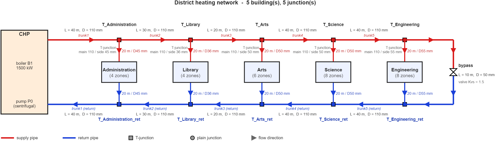
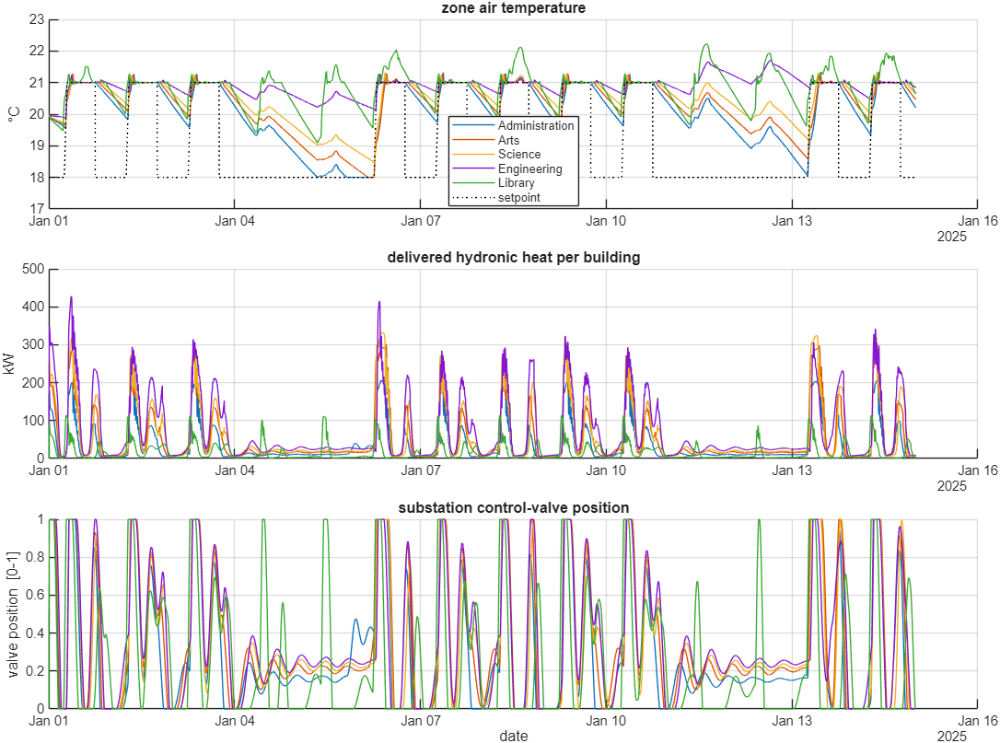

# TMSIC: Thermal Modeling for System Identification and Control

TMSIC is a MATLAB toolbox for thermal models of buildings and district heating systems. You can fit its models to
measured data, simulate them for weeks, and export them as linear state-space systems to design controllers. It
has two packages:

- **`RCBS`** describes a building as a resistance-capacitance (RC) network of storeys, zones, walls, windows and
  internal mass.
- **`DHS`** joins such buildings to a gas-fired heat plant through a pipe network with pumps, valves, heat
  exchangers and controllers.

Both are plain MATLAB, with no Simulink. This is version 1.0, the version described in the paper cited below.



## Quick start

TMSIC was developed on MATLAB R2025b and uses functions introduced in R2020a. The Control System Toolbox is needed
for `getStateSpace` and the `LQR` controller, and the Optimization Toolbox for the two identification examples. The
rest runs on base MATLAB.

```matlab
setup                              % adds the toolbox folders to the path
rcbs_tutorial                      % a two-zone building, call by call
dhs_tutorial                       % a plant, a pipe network and a building, call by call
runtests('tests')                  % 56 unit tests
run_all_validation                 % 20 accuracy checks and their figures
```

## How a model is built

A TMSIC model is assembled from named parts. Each part is an object, and each connection is a method call whose name
says what it does, so you can follow the code against the diagram.

```matlab
% A building: name its elements, then couple its zones
b = RCBS.Building();  b.addStorey('S1');
b.S1.addZone('Lab');  b.S1.addZone('Corridor');
b.S1.Lab.addWall(0.02, 2e7, [], 'Wall');
b.S1.Lab.addWindow(0.01, 'Window');
b.S1.Lab.connectToZone(b.S1.Corridor, 0.02, 'Partition', 5e6);

% A district network: connect each part to the next, or create and connect it in one call
tee1 = chp.supplyPort.addPipe(0.11, 40).addTee(0.05);        % pipe from the plant, then a tee
r1   = DHS.Hydraulic.Junction('R1', 'return');               % the return side is wired separately
r1.addPipe(0.13, 45).connect(chp.returnPort);
tee1.portC.connect(building);  building.connect(r1);         % a building hangs on the tee and drains into R1

% A control law: attach it to the actuator it drives
c = DHS.controllers.PID(0.14, 1.6e-4, 0);
c.measure = @(sys) sys.Hall.Tzone;  c.reference = @(sys) sys.Hall.setpoint;
hx.valve.attachController(c);
```

These are excerpts, so `chp`, `building` and `hx` are assumed to exist. [`docs/examples.md`](docs/examples.md) and the
tutorial scripts contain complete, runnable versions.

Four rules follow from this design:

- A part owns its parameters and its live state as properties, so you set and read them directly.
- A part can be replaced by another of the same kind without touching the rest of the model, for example a
  centrifugal pump by a fixed-displacement pump, or a PID by an LQR.
- A pipe network can be described in a declarative style (naming the two nodes of each pipe) or a connecting style.
  Both reach the same solver.
- `RCBS` never depends on `DHS`, so the building models work alone.

## What it can do

- **Model a building of any size.** Storeys, zones, walls, roofs, windows, internal mass, partitions and floor slabs,
  each added with one call. `building.visualize()` draws the network.
- **Export a linear model.** `getStateSpace` returns the continuous state-space system for controller design or
  parameter identification.
- **Assemble a district heating system.** A central plant with boilers and a pump, a pipe network with tees, and
  buildings with a heat exchanger and a control valve. A building can have an internal loop with a pump and a
  radiator and valve at every zone. Pumps are centrifugal or fixed-displacement, and valves are linear or
  equal-percentage.
- **Swap the control law.** `PID`, `LQR`, `Relay` and `Callback` share one interface, and a custom law needs two
  methods.
- **Fit models to data.** Two examples identify the RC parameters of a single zone and of an eight-zone building
  with `fmincon`.
- **Run quickly.** A five-building campus simulated for 14 days at one-minute steps (about 20,000 steps) takes about a minute.
  The 30-zone version takes about 3 minutes.
- **Trust the physics.** Twenty component checks compare each part with a closed-form solution or a published
  correlation, and 56 unit tests cover the interfaces ([validation report](validation/README.md)).

## Examples

All examples are in `examples/` and run without extra data. Start with the tutorials. They are written to be read,
with one call per line and a comment on every step. See [`docs/examples.md`](docs/examples.md) for what each one
shows and what to expect.

| Script | What it shows |
|---|---|
| `rcbs_tutorial.m` | A two-zone building built call by call, simulated, edited by name and exported as a state-space model. |
| `dhs_tutorial.m` | A plant, a pipe network and one building with a PID-controlled valve, solar gains and a schedule. |
| `dhs_internal_loop_tutorial.m` | The same building with its own water loop, radiator, bypass and three controllers. |
| `RCBS_example.m` | A three-storey, seven-zone building with partitions, slabs and two heat inputs. |
| `dhs_campus.m` | A five-building campus on one gas plant, run for 14 days. |
| `dhs_campus_with_bypass.m` | The campus with an end-of-line bypass added by one call. |
| `dhs_campus_multizone.m` | The campus with 30 zones of different room types, each with a radiator and valve. |
| `system_identification.m` | Fits a 10-parameter single-zone model to a temperature record and checks it on held-out data. |
| `multi_zone_system_identification.m` | The same procedure for an eight-zone building with 75 parameters. |



In the campus run the plant supply temperature stays between 63.4 and 74.2 °C around a 70 °C setpoint, the boiler
efficiency ranges from 0.876 to 0.942, and the energy balance closes to 0.00 % over the two weeks.

## Documentation

Each page describes one part of the toolbox: what it does, the equations behind it, its inputs and outputs, and
examples you can run.

| Page | Contents |
|---|---|
| [`docs/examples.md`](docs/examples.md) | The example scripts and what to expect from each. |
| [`docs/rcbs-building.md`](docs/rcbs-building.md) | `RCBS.Building`, `Storey`, `Zone` and `Simulation`: the RC network, its equations and the solver. |
| [`docs/dhs-system.md`](docs/dhs-system.md) | `DHS.System`: assembling and running a district heating system, and its results. |
| [`docs/dhs-building.md`](docs/dhs-building.md) | `DHS.Building`: a building on the network, with one zone or several. |
| [`docs/dhs-hydraulic.md`](docs/dhs-hydraulic.md) | Pipes, junctions, tees, both pump types and valves, with the ways of wiring a network. |
| [`docs/dhs-heat-exchanger.md`](docs/dhs-heat-exchanger.md) | The three heat exchanger types (plate, fixed effectiveness, ideal) and the substation pressure loss. |
| [`docs/dhs-internal-loop.md`](docs/dhs-internal-loop.md) | A building's internal loop: radiators with a valve per zone, the loop water and the pump. |
| [`docs/dhs-plant.md`](docs/dhs-plant.md) | `CentralHeatPlant` and `Boiler`: plant water dynamics and burner control. |
| [`docs/dhs-controllers.md`](docs/dhs-controllers.md) | `PID`, `LQR`, `Relay`, `Callback`, and how to write your own controller. |
| [`docs/dhs-solvers.md`](docs/dhs-solvers.md) | The hydraulic solvers, the time integrators and the step. |
| [`docs/dhs-weather-solar-schedule.md`](docs/dhs-weather-solar-schedule.md) | Weather data, solar gains and occupancy schedules. |
| [`docs/references.md`](docs/references.md) | The sources behind the equations and defaults. |
| [`validation/README.md`](validation/README.md) | The validation report, with a figure for every check. |

## Use TMSIC with an AI assistant

The folder [`skills/`](skills/README.md) holds a skill that teaches Claude, OpenAI Codex and other assistants how to
set up and use TMSIC with the real function names, plus instructions for a ChatGPT custom GPT. Install it with
`install_ai_skill('claude')` or `install_ai_skill('codex')`, or upload the zip from the latest release. An assistant
that can run MATLAB, for example through the MATLAB MCP Core Server, can then build and test models for you.

## Citing TMSIC

If you use TMSIC in your work, please cite:

> Darvishpour, S. and Van Heusden, K. *A MATLAB Toolbox for Thermal Modeling of Buildings and District Heating Systems for System Identification and Control (TMSIC)*, 2027

```bibtex
@misc{darvishpour_tmsic,
  author = {Darvishpour, Shahin and Van Heusden, Klaske},
  title  = {A {MATLAB} Toolbox for Thermal Modeling of Buildings and District Heating Systems for System Identification and Control ({TMSIC})},
  year   = {2027}
}
```

## License

TMSIC is free software, released under the GNU General Public License, version 3. You may use, modify and
redistribute it under the terms of that license. See [`LICENSE`](LICENSE) for the full text.
