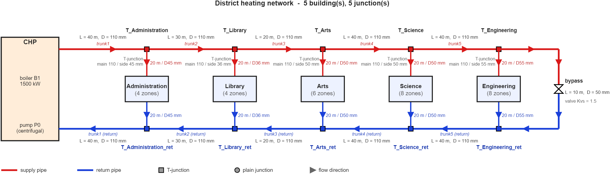

# DHS.Hydraulic: pipes, junctions, pumps and valves

The parts of a district network are in the package `DHS.Hydraulic`. The in-line parts (derived from `Link`) are
`Pipe`, `Valve` and the two pump types `CentrifugalPump` and `FixedDisplacementPump`. The nodes are `Junction`
and `TJunction`. The network that joins them, `DHS.HydraulicNetwork`, is one level up in `+DHS`.

The network is two trees that you define separately. The supply tree starts at the plant's supply port and its
pipes flow away from the plant. The return tree ends at the plant's return port and its pipes flow toward the
plant. Junctions are the branch points of each tree, and every building joins one supply junction and one
return junction. The two sides need not look alike: the return side may have other lengths, diameters,
roughness or heat loss.

Every network needs at least one pump, usually the plant's central pump. Each building's flow is set by its
valve, so the flow in one branch depends on all the others. Opening one valve raises the total flow, lowers the
head of the central pump and reduces the flow in every other branch (checked in
[`validation/README.md`](../validation/README.md), section 2.7).



## Building a network

There are three equivalent styles, and you can mix them. They all end in the same routine, so the solver cannot
tell which one you used.

- **Declarative.** Name the two nodes that each pipe joins: `hn.addPipe(nodeA, nodeB, ...)`.
- **Connecting.** Create each component and join it to the next with `a.connect(b)`. Every component has
  `connect`: a junction, a tee port, a pipe, a valve, a pump, a radiator and a building.
- **One call.** `a.addPipe(D, L)`, `addValve`, `addPump`, `addTee` and `addRadiator` create a component, connect it
  downstream of `a` and return it, so calls chain. Any property can follow as a name-value pair.

The examples below build a plant with two buildings on a trunk with two tees. They use this helper, which
creates a building with a one-zone RC model and an ideal substation. Save it as `addTestBuilding.m`:

```matlab
function b = addTestBuilding(sys, name)
    rc = RCBS.Building();  rc.addStorey('S');  rc.S.addZone('Z');
    rc.S.Z.setAir(2e7, 20);  rc.S.Z.addWindow(0.001, 'Window');
    b = sys.addBuilding(name);  b.useRCModel(rc);
    b.attachHeatExchanger(DHS.IdealHeatExchanger('HX', 'Qnom',2e5, 'Qcap',2e5));
    b.attachSolar(DHS.Solar());  b.attachSchedule(DHS.Schedule());
end
```

### Declarative style

```matlab
sys = DHS.System('weather','solar_data_2025.csv');
chp = sys.addCentralHeatPlant('CHP');
chp.addBoiler('B1', 'QMax',1e6);
chp.addPump('P0', 'dp0',3e5, 'mdotRated',6);
hn  = sys.addHydraulicNetwork();

t1 = hn.addJunction('T1', 'type','tee', 'mainDiameter',0.11, 'sideDiameter',0.05);
t2 = hn.addJunction('T2', 'type','tee', 'mainDiameter',0.11, 'sideDiameter',0.05);
hn.addPipe(chp.supplyPort, t1, 'name','pipe1', 'L',40, 'D',0.11);
hn.addPipe(t1, t2, 'name','pipe2', 'L',50, 'D',0.11);

r1 = hn.addJunction('R1', 'side','return');          % the return side, defined on its own
r2 = hn.addJunction('R2', 'side','return');
hn.addPipe(r1, chp.returnPort, 'name','ret1', 'L',45, 'D',0.13);   % flows from R1 to the plant
hn.addPipe(r2, r1, 'name','ret2', 'L',55, 'D',0.13);

hn.connectBuilding(t1, addTestBuilding(sys, 'North'), r1);   % supply junction, building, return junction
hn.connectBuilding(t2, addTestBuilding(sys, 'South'), r2);

sys.compile();
s = hn.solve(1);            % solve with the central pump at full speed
```

### Connecting style

`a.connect(b)` makes `b` the next component downstream of `a`. The order of the calls does not matter between
chains: the network is found by following the connections from the plant when it is solved.
(`connectToPipe` and `connectOutput` are aliases of `connect`.)

```matlab
sys = DHS.System('weather','solar_data_2025.csv');
chp = sys.addCentralHeatPlant('CHP');
chp.addBoiler('B1', 'QMax',1e6);
chp.addPump('P0', 'dp0',3e5, 'mdotRated',6);
hn  = sys.addHydraulicNetwork();

pipe1 = DHS.Hydraulic.Pipe('pipe1', 'L',40, 'D',0.11);
chp.supplyPort.connect(pipe1);                       % plant output -> pipe1
t1 = DHS.Hydraulic.TJunction('T1', 'mainDiameter',0.11, 'sideDiameter',0.05);
pipe1.connect(t1);                                   % pipe1 -> tee T1

pipe2 = DHS.Hydraulic.Pipe('pipe2', 'L',50, 'D',0.11);
t1.portB.connect(pipe2);                             % the run of T1 -> pipe2
t2 = DHS.Hydraulic.TJunction('T2', 'mainDiameter',0.11, 'sideDiameter',0.05);
pipe2.connect(t2.portA);                             % pipe2 -> the inlet of tee T2

r1 = DHS.Hydraulic.Junction('R1', 'return');         % the return side, wired the same way
r2 = DHS.Hydraulic.Junction('R2', 'return');
ret1 = DHS.Hydraulic.Pipe('ret1', 'L',45, 'D',0.13);
r1.connect(ret1);   ret1.connect(chp.returnPort);    % R1 -> plant
ret2 = DHS.Hydraulic.Pipe('ret2', 'L',55, 'D',0.13);
r2.connect(ret2);   ret2.connect(r1);                % R2 -> R1

north = addTestBuilding(sys, 'North');  south = addTestBuilding(sys, 'South');
t1.portC.connect(north);  north.connect(r1);         % a building hangs on the side port of a tee
t2.portC.connect(south);  south.connect(r2);         % and drains into a return junction

sys.compile();
s = hn.solve(1);
```

### One-call style

```matlab
t1 = chp.supplyPort.addPipe(0.11, 40, 'name','pipe1').addTee(0.05, 'name','T1');   % pipe, then a tee
t2 = t1.portB.addPipe(0.11, 50, 'name','pipe2').addTee(0.05, 'name','T2');
r1 = DHS.Hydraulic.Junction('R1', 'return');
r2 = DHS.Hydraulic.Junction('R2', 'return');
r1.addPipe(0.13, 45, 'name','ret1').connect(chp.returnPort);
r2.addPipe(0.13, 55, 'name','ret2').connect(r1);
t1.portC.connect(north);  north.connect(r1);
t2.portC.connect(south);  south.connect(r2);
```

`addPipe(D, L)` takes the diameter and the length, and `addTee(sideD)` on a pipe makes a tee with the pipe's
diameter. The same calls exist for valves (`addValve('Kvs',4)`), pumps (`addPump('dp0',3e4, 'mdotRated',1)`)
and radiators (`addRadiator('rad1', 'Qdes',8e3)`); see [the internal loop](dhs-internal-loop.md). `attach` is
used only for controllers (`valve.attachController(c)`) and for the parts of a building.

All three scripts give the same result to the last digit:

```
s.mdot   = [3.9375  3.9235]   kg/s      (North, South)
s.Mtot   = 7.8609             kg/s
s.dpPump = 171,263            Pa
```

A building's service connection has the length `building.connLength` and the diameter `building.connD` for both
of its pipes (`building.connPipeSup` and `building.connPipeRet`, which you can edit separately). The last hop to
a building is `supplyNode.connect(building); building.connect(returnJunction)`, and the return junction may be
the plant's `chp.returnPort`. When the supply node is a tee, the building takes the side branch (`portC`) unless
you connect it to `portB`.

### Parts by name

Every junction and pipe is reachable on the network by its name, so you can read or change a part without
searching the cell arrays. A tee's ports are objects too:

```matlab
hn.pipe1.L = 60;                       % supply pipe 1; the return pipes are separate (hn.ret1.L)
hn.T1.portC.D = 0.06;                  % side-branch diameter of tee T1 (portA and portB: main diameter)
hn.T1.portC.p                          % gauge pressure at the tee, live
hn.T1.portB.pipe.mdot                  % the pipe attached to the run (portC.pipe: the branch)
hn.pipe2.Input.p - hn.pipe2.Output.p   % pressure at the two ends of a pipe
hn.R2.p                                % gauge pressure at return junction R2
```

Names are yours: the toolbox gives no part a fixed name. The plant is `sys.CHP` with its boilers and pump
(`sys.CHP.B1.QMax`, `sys.CHP.P0.dp0`), and a building is `sys.North` with its exchanger and the exchanger's valve
and pump. Every part takes its parameters as name-value pairs when you create it and as plain assignment
afterwards: `hn.addPipe(a, b, 'name','pipe1', 'L',40, 'D',0.11)` and `hn.pipe1.D = 0.15`. A name that is not a
valid MATLAB identifier is not registered (the declarative default `'CHP.supply->T1'` is one), so give each pipe a
`'name'`. A name that a property of the object already uses, such as `pipes`, is skipped with a warning.

### Swapping a part

A pump or a valve can be replaced after the network is built. Here the North substation gets a
fixed-displacement booster pump that delivers 3 kg/s, capped at 250 kPa. A pump you attach runs at full speed
until you change `speed`.

```matlab
north = sys.buildings{1};
north.heatExchanger.attachPump( ...
    DHS.Hydraulic.FixedDisplacementPump('North.pump', 'mdotRated',3, 'dpMax',2.5e5) );
sys.compile();
s = hn.solve(1);            % s.mdot = [3.0000  4.1747]
```

North receives exactly its commanded flow, and South, which shares the trunk, adjusts.

## Models

### Pipe

Pressure drop follows Darcy–Weisbach with the explicit Swamee–Jain friction factor [16](references.md#r16),
an approximation of the implicit Colebrook–White equation [17](references.md#r17):

$$\Delta p = K\,\dot m^2,\qquad K = \frac{f\,L}{D\cdot 2\rho A^2},\qquad
f = \frac{0.25}{\left[\log_{10}\!\left(\dfrac{\varepsilon/D}{3.7}+\dfrac{5.74}{\mathrm{Re}^{0.9}}\right)\right]^2}.$$

The factor is clamped to 0.008 to 0.1, and $f = 64/\mathrm{Re}$ below $\mathrm{Re} = 2300$. A pipe also loses heat
to the ground. For a flow $\dot m$ and a loss coefficient $U'$ (W/m/K), water entering at $T_\text{in}$ leaves at

$$T_\text{out} = T_g + (T_\text{in} - T_g)\,\exp\!\left(-\frac{U' L}{\dot m\,c_p}\right).$$

The network applies this to every supply and return pipe with the flow that pipe carries. A junction splits the
flow and passes the temperature on without loss; in the return tree, the streams that meet at a junction mix by
enthalpy flow. This matches MathWorks' Simscape Pipe (TL) block [50](references.md#r50): the same $K\dot m^2$
term and the same laminar law. Simscape uses the Haaland equation instead of Swamee–Jain for turbulent flow,
which agrees within about 2% [18](references.md#r18). Pipes here are level (no hydrostatic term) and the
network is solved quasi-statically, without fluid inertia.

### T-junction and flow split

A tee splits the incoming flow $\dot m_A$ between the straight run (port B, flow $\dot m_B$) and the side branch
(port C, flow $\dot m_C$), where a building usually hangs. The split is not a fixed ratio. Mass is conserved, the
run carries the flow of every building downstream of it, and the branch flow follows from the pressure $p_T$ at the
tee across the branch resistance $K_C$ to the return pressure $p_R$:

$$\dot m_A = \dot m_B + \dot m_C,\qquad \dot m_B = \sum_{b\,\in\,\text{run}} \dot m_b,\qquad
\dot m_C = \sqrt{\frac{p_T - p_R}{K_C}},\qquad p_T = p_0 - \sum_j K_j\,Q_j^2 ,$$

where $p_0$ is the plant pressure, $K_j$ and $Q_j$ are the resistance and flow of the pipes between the plant and
the tee, and a booster pump on the branch adds its head to the numerator. All tees are solved together, because
$p_T$ depends on the flows downstream.

The tee also adds a small minor loss to the pipe that leaves it, by the equivalent-length method for a standard
tee: 20 pipe diameters for the run and 60 for the branch,

$$K_\text{run} = f(\mathrm{Re}_\text{main})\,\frac{20}{2\rho A_\text{main}^2},\qquad
K_\text{branch} = f(\mathrm{Re}_\text{side})\,\frac{60}{2\rho A_\text{side}^2},$$

with the friction factor $f$ of the pipe model. The loss is part of $K_j$ for the run pipe and of $K_C$ for the
branch. It is applied on the supply side only. This is the default "Crane correlation" of Simscape's T-Junction
(TL) block [51](references.md#r51), which cites Crane TP-410 (1981) [52](references.md#r52). Later correlations
[23](references.md#r23), [24](references.md#r24), [53](references.md#r53) depend on the flow split and the
branch angle, and are not used here. `frictionModel` chooses the Reynolds number for $f$: `'fixed'` (default) uses
$10^7$, the fully turbulent value for which the constants 20 and 60 were calibrated, and `'actual'` uses the
leg's own flow. For a 0.10 m main and a 0.05 m side leg the two coefficients are 2.73 and 153.5 Pa/(kg/s)².

### Centrifugal pump

A centrifugal pump is defined by its data-sheet curve at the maximum speed $n_\text{max}$ and by the speed it
runs at. The head–flow curve is the parabola through the shut-off head $\Delta p_0$ and a duty point (flow
$\dot m_r$, head $\Delta p_r$). Speed scaling follows the affinity laws: flow proportional to speed and head to
its square (Karassik et al. [25](references.md#r25); Gülich [26](references.md#r26)):

$$H(\dot m, s) = s^2\,\Delta p_0 - K_p\,\dot m^2,\qquad K_p = \frac{\Delta p_0 - \Delta p_r}{\dot m_r^2},\qquad s = \frac{n}{n_\text{max}} .$$

The flow and head the pump delivers are where this curve meets the resistance of the network. On a branch of
resistance $K$ with differential pressure $\Delta p_\text{avail}$ already at its tee, the flow is

$$\dot m = \sqrt{\frac{s^2\Delta p_0 + \Delta p_\text{avail}}{K + K_p}}.$$

This is the quadratic special case of Simscape's Centrifugal Pump (TL) [54](references.md#r54). The head falls
to zero at the free-delivery flow $\dot m_r\sqrt{\Delta p_0/(\Delta p_0-\Delta p_r)}$, available as
`pump.mdotFree`.

### Fixed-displacement pump

A gear, screw or piston pump delivers a flow set by its speed almost regardless of the pressure, until a relief
valve opens (Karassik et al. [25](references.md#r25)):

$$\dot m = \min\!\left(s\,\dot m_\text{rated},\ \sqrt{\frac{\max(0,\ \Delta p_\text{max} + \Delta p_\text{avail})}{K}}\right).$$

As the central plant pump, this type reports its relief pressure $\Delta p_\text{max}$ as the header head whenever
it runs. A full positive-displacement solve, in which the pump sets the flow of the whole network, is not
implemented. Simscape's Fixed-Displacement Pump (TL) [55](references.md#r55) also models leakage and friction.

### Control valve

The valve follows the IEC 60534 flow coefficient [22](references.md#r22), $Q\,[\mathrm{m^3/h}] = K_v\sqrt{\Delta p\,[\mathrm{bar}]}$,
which gives $\Delta p = K\,\dot m^2$ with $K = 10^5\cdot 3600^2/(K_v^2\rho^2)$. The coefficient depends on the travel
`pos` through the inherent characteristic: linear ($K_v/K_{vs} = \text{pos}$) or equal-percentage
($K_v/K_{vs} = R^{\text{pos}-1}$, with rangeability $R$, usually 25 to 50). Travel is floored at `minPos`
(0.02 by default) to avoid a division by zero.

**Actuator lag.** `pos` is the command, set by you or by a controller. During a run the valve follows it with a
first-order lag of time constant `lag` (default 60 s), and the flow uses the position the valve has reached,
`posActual`:

$$x_{k+1} = x_k + \left(1 - e^{-\Delta t/\tau}\right)(\text{pos} - x_k).$$

Use `valve.lag = 10` for a fast actuator and `valve.lag = 0` for an ideal valve. Outside a run the command is
used as it is. Simscape's Gate Valve (TL) block [58](references.md#r58) models a different valve type, based on a
discharge coefficient and a gate opening area.

## Bypass and pump control

**Bypass.** A pipe or valve joined from the supply side to a return junction carries water straight across: it
is a bypass. It is one more branch of the network, with the flow `valve.mdot`. It takes the water the buildings
do not draw, so a pump that holds a constant flow has somewhere to put it. You can add any number of them, and
their valves take controllers like any other:

```matlab
tee.portB.addPipe(0.05, 5).addValve('Kvs',2).connect(returnJunction);
```

A network does not need a bypass: with the valves nearly shut, a pump under pressure control slows down instead.
For an end-of-line bypass in one call, `hn.addBypass(...)` joins the last supply junction to a return junction
through a pipe and a valve (see the reference). It is counted in the flow of every upstream pipe and in the
plant flow, loses heat in its own pipe, and its water joins the return by enthalpy mixing.

**Controlling the bypass valve.** The valve holds the position given to `addBypass` unless you attach a
controller. The controller is sampled once per step on the previous step's pressures:

```matlab
c = DHS.controllers.PID('Kp',1/2e5, 'Ki',0, 'dir',-1);                  % open when dp > reference
c.measure   = @(sys) hn.bypassJunction.p - hn.bypassReturnJunction.p;    % across the bypass [Pa]
c.reference = 3.5e5;                                                    % [Pa]
hn.bypassValve.attachController(c);
```

**Controlling the central pump.** The central pump runs at `sys.pumpFrac` unless it has a controller. This one
holds the supply-minus-return pressure at the last tee:

```matlab
c = DHS.controllers.PID('Kp',2.5e-7, 'Ki',2.1e-9, 'uMin',0.3);
c.measure   = @(sys) hn.T2.p - hn.R2.p;                    % [Pa]
c.reference = 3.0e5;                                       % [Pa], or a function @(sys) ...
chp.supplyPump.attachController(c);
```

The measure can be anything the controller reads from `sys`: the pump head, another junction, a flow. The
reference can change with time (`sys.time`).

## Function reference

### `DHS.Hydraulic.Pipe`

| Function or property | Inputs | Output or effect |
|---|---|---|
| `Pipe(name, 'L',L, 'D',D, 'eps',e, 'UperM',U)` | name; length (m, default 50), inner diameter (m, 0.1), roughness (m, 4.6e-5), heat-loss coefficient (W/m/K, 0.30) | A pipe with no ends yet. `Pipe(name, nodeA, nodeB, ...)` also sets the ends. |
| `connect(dst)` | a junction, tee port, pipe, valve, pump, radiator or building | Joins the pipe's downstream end to `dst` (a node is made between two components). |
| `addPipe(D, L, ...)`, `addValve(...)`, `addPump(...)`, `addTee(sideD, ...)`, `addRadiator(name, ...)` | sizes or properties as name-value pairs | Creates the component, connects it downstream and returns it. The same on a junction, tee port, valve, pump, radiator and building. |
| `addTjunction(name, sideDiameter)` | name; side-leg diameter (m) | Creates a `TJunction` with this pipe's diameter at its downstream end and returns it. |
| `resistance(mdot, rho, mu)` | flow (kg/s), density (kg/m³), viscosity (Pa·s) | $K$ in Pa/(kg/s)², including any tee loss. |
| `outletTemperature(Tin, Tground, mdot, cp)` | inlet and ground temperatures (degC), flow (kg/s), specific heat (J/kg/K) | `[Tout, Qloss]`: outlet temperature (degC) and heat lost (W). |
| `.Input`, `.Output` | none | The nodes the pipe starts and ends at (`.p`, `.T`). |
| `.mdot`, `.vel`, `.dp`, `.f` | none | Live flow, velocity, pressure drop and friction factor. |
| `.Tin`, `.Tout`, `.Tdrop`, `.Qloss` | none | Live inlet and outlet temperature, temperature drop and heat loss. |

### `DHS.Hydraulic.Junction` and `TJunction`

| Function or property | Inputs | Output or effect |
|---|---|---|
| `Junction(name, side)` | name; `'supply'` or `'return'` | A node of the supply or the return tree. |
| `connect(x)`, `addPipe(...)`, ... | a pipe, valve, pump, radiator or building | Attaches the component downstream of the node. |
| `TJunction(name, 'mainDiameter',Dm, 'sideDiameter',Ds, 'roughness',e, 'frictionModel',m)` | name; diameters (m); roughness (m, 4.6e-5); `'fixed'` or `'actual'` | A tee with the ports `portA` (inlet), `portB` (run) and `portC` (side branch). |
| `portB.connect(x)`, `portC.connect(x)` | a pipe, valve, pump, radiator or building | Wires the run or the side branch. A radiator or building goes to `portC` unless you use `portB`. |
| `connect('portB', x)`, `connect('portC', x)` | port name, a component | The same wiring with the port named as text. `connect(pipe)` alone means `portB`. |
| `portX.D` | none | Diameter at the port (m), read and write: the main diameter for `portA` and `portB`, the side diameter for `portC`. |
| `portX.p`, `portX.T`, `portX.pipe` | none | Gauge pressure (Pa) and temperature (degC) at the tee, and the pipe attached to that port (`[]` if none). |
| `teeLossK(side, rho, mu, mdot)` | `'run'` or `'branch'`, density, viscosity, flow (kg/s, used only with `'actual'`) | $K_\text{run}$ or $K_\text{branch}$ in Pa/(kg/s)². |
| `.p`, `.T`, `.mdotThrough` | none | Live gauge pressure (Pa), water temperature (degC) and through flow (kg/s). |

### `DHS.Hydraulic.CentrifugalPump` and `FixedDisplacementPump`

| Function or property | Inputs | Output or effect |
|---|---|---|
| `CentrifugalPump(name, 'dp0',dp0, 'mdotRated',m, 'dpRated',h, 'nMax',n, 'minSpeed',s)` | name; shut-off head (Pa, default 1e5); flow (kg/s, 5) and head (Pa, default 75 % of `dp0`) of the duty point at full speed; maximum speed (rpm, 2900); speed floor | A centrifugal pump. `speed` is the fraction of `nMax`, and `rpm` the speed in rpm (setting either sets the other). |
| `FixedDisplacementPump(name, 'mdotRated',m, 'dpMax',dp, 'minSpeed',s)` | name; rated flow (kg/s, 5); relief pressure (Pa, 4e5); speed floor | A positive-displacement pump. |
| `curveHead(mdot, frac)` | total flow (kg/s), speed fraction | Head (Pa) at the plant header: the central-pump role. |
| `solveBranch(K, dpAvail, frac)` | branch resistance, available differential pressure (Pa), speed fraction | `[m, h]`: the flow and head the pump settles to on that branch (the substation-pump role). |
| `attachController(c)` | a `DHS.controllers.Controller` | Drives `.speed` from the controller at every step. |
| `.speed`, `.minSpeed` | 0 to 1 | Speed command and its floor. Speed 0 means stopped: as a substation pump it adds no head and no resistance, and the branch flow is $\sqrt{\Delta p/K}$. A building's pump is stopped by default. |
| `.head`, `.mdot` | none | Live head and flow. |
| `.mdotFree`, `.rpm` | none | Free-delivery flow (read only) and the speed in rpm. |
| `inlineCurve()` | none | `[K, H]`: the in-line pump curve at the current speed, head $= H - K\dot m^2$ (centrifugal only). |
| `connect(dst)` | a node or another component | Wires an in-line pump's downstream end, like a pipe's. |

**In-line pump.** A centrifugal pump can also sit between two nodes, like a pipe, and add its head there. Wire it
like a pipe: `nodeA.connect(pump); pump.connect(nodeB)`, `pipe.addPump('dp0',dp0, 'mdotRated',m)`, or
`hn.addPump(nodeA, nodeB, 'dp0',dp0, 'mdotRated',m)`. The pressure walk treats it as a link with a loss
$K\dot m^2$ and a gain $H$. A stopped in-line pump (speed 0) has no head and no resistance. A building's
[internal loop](dhs-internal-loop.md) has its pump in line.

Example values for $\Delta p_0 = 300$ kPa and a duty point of 7 kg/s (head 225 kPa, the default 75 %), so that
$\dot m_\text{free} = 14$ kg/s: the head is 300 kPa at zero flow, 202 kPa at 8 kg/s and 94 kPa at 8 kg/s and
speed 0.8. On a branch with $K = 3000$ Pa/(kg/s)² the pump settles at 8.14 kg/s. A fixed-displacement pump
(5 kg/s, 300 kPa) on the same branch delivers 5.00 kg/s, and on a branch with $K = 4\times10^5$ it is limited to
0.87 kg/s.

### `DHS.Hydraulic.Valve`

| Function or property | Inputs | Output or effect |
|---|---|---|
| `Valve(name, 'Kvs',Kvs, 'char',c, 'rangeability',R, 'minPos',p, 'lag',tau)` | name; rated $K_v$ (m³/h/√bar, default 25); `'eqpct'` (default) or `'linear'`; rangeability (50); lowest travel (0.02; 0.001 shuts tight); actuator time constant (s, 60; 0 for none) | A control valve. The same valve serves a building, a radiator or a bypass, and sits in line like a pipe. |
| `Valve.kvsFor(mdot, dp, rho)` | flow (kg/s), pressure drop when fully open (Pa), density | The rated $K_v$ that passes `mdot` at `dp`. |
| `connect(dst)`, `addPipe(...)`, ... | as for a pipe | Joins the valve to the next component. A valve joined from the supply side to a return junction is a bypass. |
| `.pos`, `.posActual` | 0 to 1 | The travel command (fixed unless a controller is attached), and the travel the valve has reached (equal outside a run or with `lag` 0). |
| `.mdot`, `.dp` | none | Live flow and pressure drop. |
| `resistance(rho, pos)` | density (kg/m³), travel 0 to 1 (default `.pos`) | $K$ in Pa/(kg/s)². |
| `attachController(c)` | a `Controller` | Drives `.pos` at every step. The controller chooses what to measure. |

For $K_{vs} = 18$ and $R = 50$ the resistance is 4,182 Pa/(kg/s)² fully open, which is 37.6 kPa at 3 kg/s. At
half travel it is 209,099 Pa/(kg/s)².

### `DHS.HydraulicNetwork`

| Function or property | Inputs | Output or effect |
|---|---|---|
| `addJunction(name, 'type',t, ...)` | name; `'plain'` (default) or `'tee'`; any junction property, for a tee `'mainDiameter'`, `'sideDiameter'`, `'roughness'`, `'frictionModel'`; `'side','return'` for a return junction | A junction, reachable as `hn.<name>`. |
| `addPipe(nodeA, nodeB, 'name',n, 'L',L, 'D',D, ...)` | two nodes (junctions or `chp.supplyPort`); any pipe property | Registers a pipe, reachable as `hn.<name>` when `name` is a valid identifier. Returns the pipe. |
| `addPump(nodeA, nodeB, 'name',n, 'dp0',dp0, 'mdotRated',m, ...)` | two nodes of the same tree; any pump property | Places an in-line centrifugal pump between the nodes and returns it. |
| `connectBuilding(supplyJunction, building, returnJunction)` | a supply junction, a `DHS.Building`, a return junction (or `chp.returnPort`) | Declarative form of `supplyJunction.connect(building); building.connect(returnJunction)`. |
| `addBypass(supplyJunction, returnJunction, 'name',n, 'L',L, 'D',D, 'Kvs',Kvs, 'pos',p, ...)` | the supply junction it leaves and the return junction it joins; any pipe property (`name` default `'bypass'`, `L`, `D`, `eps`, `UperM`) and valve property (`Kvs`, `pos` default 1, `char`, `rangeability`, `minPos`) | Joins the two through a pipe and a valve. The pipe is `hn.<name>` and `hn.bypassPipe`, the valve `hn.bypassValve`. `hasBypass()` tells whether one exists. |
| `discover()` | none | Registers everything connected to the plant but not yet listed. `compile` calls it. |
| `compile()` | none | Freezes the topology into index arrays. `solve` calls it when needed. |
| `solve(pumpFrac)` | central pump speed, 0 to 1 (default 1) | A structure with `Mtot` (kg/s, buildings plus bypass), `mdotBypass`, `dpPump` and `pSupHeader` (Pa), and per building `mdot`, `vel`, `pSupBranch`, `pRetBranch`. |
| `supplyTemperatures(Tplant, Tground, m, cp)` | plant supply temperature, ground temperature (degC), building flows (kg/s), specific heat | `[TsupHx, Qloss]`: water temperature at each building's exchanger inlet (degC) and the total supply-side heat loss (W). |
| `returnTemperatures(Thx, Tground, m, cp)` | exchanger outlet temperatures (degC), ground temperature, flows, specific heat | `[Tret, Qloss]`: temperature arriving at the plant (degC) and the total return-side heat loss (W), with enthalpy mixing at each junction. |
| `.rho`, `.mu`, `.pReturnRef` | scalars | Density (978 kg/m³), viscosity (4.0e-4 Pa·s) and the return-side reference gauge pressure (1.5e5 Pa). |
| `.solver`, `.maxIter`, `.tol`, `.damping`, `.andersonDepth` | see [solvers](dhs-solvers.md) | The flow solver and its settings. |
| `.junctions`, `.returnJunctions`, `.pipes`, `.returnPipes`, `.buildings` | none | The registered parts, as cell arrays. |
| `.bypassPipe`, `.bypassValve`, `.bypassJunction`, `.bypassReturnJunction` | none | The parts of the end-of-line bypass (empty without one). |

**How the solver works.** It walks the tree from the plant and computes each segment's flow from the branch flows
below it. It subtracts $K\,\dot m^2$ along every link (pipes and valves lose pressure, in-line pumps gain head),
closes each building branch through its own pump's `solveBranch`, and finds the branch flows with Newton's method
(see [solvers](dhs-solvers.md)). A chain of links that carries the flow of a single branch, such as a valve and the
pipes before a radiator, is added to that branch's resistance, so a nearly shut valve does not make the iteration
stiff. `DHS.System` then calls `supplyTemperatures` and `returnTemperatures` with those flows each step.

A branch flow is not fixed by its diameter. It follows from the pressure balance at its junction: the differential
pressure left by the central pump and the trunk friction equals the branch's total resistance,
$K = K_\text{service pipes} + K_\text{valve}(\text{pos}) + K_\text{exchanger} + K_\text{minor}$ (plus the tee's branch
loss), minus the head of a booster pump if one runs. The diameters enter only through the pipe and fitting
resistances. The valve position changes $K_\text{valve}$ directly, so closing a valve cuts that branch's flow and
raises the pressure left for the others. The accuracy of the solver is checked against closed-form solutions in
[`../validation/README.md`](../validation/README.md).
