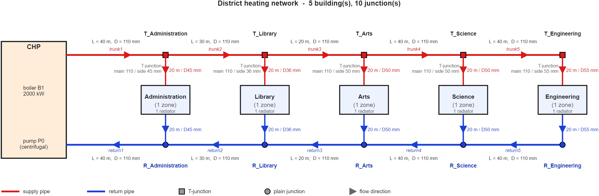

# DHS.System: assembling and running a district heating system

`DHS.System` is the top-level object of the district heating package. It owns one
central heat plant, one hydraulic network and any number of buildings, and it advances
all of them together on a fixed time step. You build a system by naming its parts and
connecting them, then call `run`. Assembly code follows the plant diagram, so a
reader can compare the script with the drawing.



## Example

Below, a script builds a one-building system, draws it and simulates one week. It models an
office hall with a 4 kW/K envelope, a substation with a PID-controlled valve, and a
schedule that occupies the hall from 07:00 to 18:00.

```matlab
rc = RCBS.Building();                                    % thermal model of the hall
rc.addStorey('S1');
rc.S1.addZone('Hall');
rc.S1.Hall.setAir(2e7, 20);
rc.S1.Hall.addWall(0.0004, 3e8, [], 'Wall');
rc.S1.Hall.addWindow(0.00067, 'Window');
rc.S1.Hall.addInternalMass(0.0002, 5e8, [], 'Mass');

sys = DHS.System('weather','solar_data_2025.csv', 'startDate',datetime(2025,1,1));

chp = sys.addCentralHeatPlant('CHP');                    % plant: one boiler, one pump
chp.addBoiler('B1', 'QMax',1.0e6);
chp.addPump('P0', 'dp0',3.0e5, 'mdotRated',6);
chp.setSupplySetpoint(70);

hn = sys.addHydraulicNetwork();                          % network: a supply and a return junction, a pipe each
t1 = hn.addJunction('T1');
hn.addPipe(chp.supplyPort, t1, 'L',40, 'D',0.10);
r1 = hn.addJunction('R1', 'side','return');               % the return side, defined separately
hn.addPipe(r1, chp.returnPort, 'L',40, 'D',0.10);

b  = sys.addBuilding('Hall');                            % building and its substation
b.useRCModel(rc);
hx = b.addHeatExchanger('HX', 'UA',8e3, 'Qcap',2e5);
c = DHS.controllers.PID(0.14, 1.6e-4, 0);
c.measure = @(sys) b.Tzone;  c.reference = @(sys) b.setpoint;   % zone temperature held at the setpoint
hx.valve.attachController(c);
b.attachSolar( DHS.Solar('winArea',struct('N',20,'E',20,'S',20,'W',20), ...
    'SHGC',0.4, 'massFraction',0.1) );
b.attachSchedule( DHS.Schedule('occStartHour',7, 'occEndHour',18, 'rampHours',1, ...
    'Tocc',21, 'Tsetback',18, 'gainOccW',20e3, 'gainMassFraction',0.3) );
hn.connectBuilding(t1, b, r1);

sys.visualize();                                         % draw the assembled system
res = sys.run(days(7));                                  % 10,081 one-minute steps
```

Running it takes about 5 s. During occupied hours the zone temperature follows the 21 degC
setpoint with a mean bias of +0.02 K and a root-mean-square deviation of 0.07 K, and it
falls to 17.6 degC overnight. Supply temperature at the plant stays between 69.5 and
75.8 degC around its 70 degC setpoint. Over the week the boiler burns 13,510 kWh of gas
and the substation delivers 10,102 kWh to the building. Closure of the energy balance
is 1e-10 of the gas input, the quantity `res.energy.closure_err` reports.

The result structure has the fields below. Every field is a vector with one value per
time step unless stated otherwise.

| Field | Content |
|---|---|
| `res.time`, `res.Tout` | Time stamps (`datetime`) and outdoor temperature (degC). |
| `res.plant.Tsupply`, `.Tboiler`, `.Treturn`, `.TreturnNet`, `.TsupSet` | Plant temperatures (degC): supply, boiler water, return header, return from the network, supply setpoint. |
| `res.plant.Qgas`, `.Qboiler`, `.Qdist_loss`, `.Qbase`, `.eta`, `.firing` | Gas input, heat to the water, distribution loss (W), base load (W), efficiency, burner firing fraction. |
| `res.plant.Mtot`, `.Mbypass`, `.dpPump`, `.pSupHeader` | Total flow (kg/s), the part of it that passes through the end-of-line bypass (0 without one), central pump head (Pa) and supply-header gauge pressure (Pa). |
| `res.plant.pumpSpeed`, `.bypassPos` | Central pump speed and bypass valve position (0 to 1). |
| `res.bldg(i).Tzone`, `.setpoint`, `.Tzones`, `.zoneNames` | Air temperature and setpoint (degC); per-zone temperatures for a multi-zone building. |
| `res.bldg(i).Qdeliv`, `.Qsolar`, `.Qint`, `.Qvent`, `.Qfreecool` | Heat delivered by the substation, solar gain, internal gain, ventilation loss, free cooling (W). |
| `res.bldg(i).valve`, `.pump`, `.mdot`, `.vel` | Valve position and booster pump speed (0 to 1, the pump is stopped by default), branch flow (kg/s), velocity (m/s). |
| `res.bldg(i).Tint_sup`, `.Tint_ret`, `.mdot_int`, `.Qzones` | Internal loop supply and return temperature (degC) and flow (kg/s), and the heat each zone receives (W, one column per zone). The temperatures and flow are NaN or zero for an ideal substation. |
| `res.bldg(i).Tsup_hx`, `.Tret_primary`, `.pSup`, `.pRet` | Primary supply and return temperatures at the exchanger (degC) and gauge pressures at the tee (Pa). |
| `res.energy.gas_kWh`, `.boiler_kWh`, `.delivered_kWh`, `.dist_loss_kWh`, `.base_kWh` | Scalars: energy totals over the run. |
| `res.energy.plant_eff`, `.closure_err` | Scalars: delivered plus losses over gas input, and the relative closure error of the energy balance. |

## What happens in one time step

The scheme is sequential (Gauss–Seidel), with an inner loop that makes the plant supply
temperature consistent with the network return.

1. Sample the weather and call `stepFunction(sys)`, if there is one.
2. Each building's schedule and solar model produce a setpoint, occupancy and heat gains.
3. Each building's controllers compute valve (and booster pump) commands. The central pump and the bypass valve run their own controllers, if any, on the previous step's measurement.
4. Branch flows, velocities and node pressures come from the hydraulic network solve.
5. The plant's firing controller sets the burner input.
6. Supply-pipe heat loss sets each exchanger's inlet temperature, each exchanger delivers
   heat, return-pipe loss and mixing set the plant return temperature, and the boiler is
   re-evaluated. Step 6 repeats `couplingIterations` times.
7. New water temperatures are committed to the plant.
8. Each building advances its RC model by one step.
9. Signals are logged.

## Start, step and stop functions

Three hooks let a script act on the system while it runs. Each one is a function handle that
receives the whole system, `sys`, as controllers do, and may read or change anything in it:

| Hook | Called | Typical use |
|---|---|---|
| `sys.startFunction` | once, before the run starts | set parameters, prepare your own data |
| `sys.stepFunction` | at the start of every step, after the weather is sampled and before the controllers run | change parameters with time, log signals |
| `sys.stopFunction` | once, after the last step; `sys.result` holds the results | collect data, post-process, add fields to `sys.result` |

Inside a hook, `sys.time` is the start of the step, `sys.stepIndex` its number, and `sys.wx` its
weather: `sys.wx.Tout` and `sys.wx.Tground` in degC, `ghi`, `dhi`, `dni` in W/m², the sun angles `sunZen`,
`sunAz`, `sunEl` and `albedo`. The whole record is `sys.weather`. An anonymous function cannot assign, so
a hook that changes something or stores data is a named function, which can sit at the end of the script. This script logs the outdoor temperature, lets
the boiler efficiency drift, changes the supply setpoint after 100 steps and adds a field to the results:

```matlab
sys.startFunction = @startRun;  sys.stepFunction = @eachStep;  sys.stopFunction = @endRun;
res = sys.run(days(2));                          % res.meanTout is set by endRun

function startRun(sys)
    sys.plant.TsupSet = 65;                      % a parameter, before the run
    sys.userData.Tout = [];                      % your own data: here, a log of the outdoor temperature
end

function eachStep(sys)
    sys.userData.Tout(end+1) = sys.wx.Tout;                          % collect data
    sys.plant.boilers{1}.etaRef = 0.92 - 1e-6*sys.stepIndex;         % a parameter changing with time
    if sys.stepIndex == 100, sys.plant.TsupSet = 60; end
end

function endRun(sys)
    sys.result.meanTout = mean(sys.userData.Tout);                   % post-process
end
```

### Parts by name

The plant, the network and the buildings are reached by the names you gave them (the network parts are described on the [hydraulics page](dhs-hydraulic.md)), and so are a building's storeys, zones and elements: so a hook can
read and write them directly: `sys.Library.Storey1.Zone2.Wall.R`. A building is `sys.<name>` (a name
that is not a valid identifier, or that a property of `sys` already uses, is available only as
`sys.buildings{i}`). Every wall, roof, window and internal mass has `R` (total resistance, K/W) and,
where it has mass, `C` (J/K) and `T` (degC, read-only); the zone's air node is `Air`. A window has
no mass, so no `C` or `T`. Writing `R` or `C` changes the RC model and the running simulation picks
the change up on its next step, keeping the temperatures. This hook halves a window resistance of the
Administration building at step 500:

```matlab
function rcHook(sys)
    if sys.stepIndex == 500
        z = sys.Administration.S1.Z;
        z.Window.R = z.Window.R / 2;
    end
end
```

### Sharing data with controllers

Controllers and hooks may use variables of your script, but only in the form of a closure: an
anonymous function takes a copy of each workspace variable when it is created, so a later change to
the variable is not seen, and a named function (such as the hooks above) sees none of the script's
variables. Constant data, such as an occupancy table, can therefore be captured:

```matlab
occ = [zeros(1,300), ones(1,300), zeros(1,840)];                 % one value per step
c = DHS.controllers.Callback(@(sys, dt) 0.1 + 0.8*occ(sys.stepIndex));
```

`sys.userData` is a structure that is yours. The toolbox never reads or changes it. Put anything in it, such as
`sys.userData.schedule = ...`, and every controller and hook reads it through `sys`. This start function writes
an occupancy schedule, and a building valve follows it:

```matlab
function startRun(sys)
    sys.userData.occ = [zeros(1,300), ones(1,300), zeros(1,840)];
end

valve = DHS.controllers.Callback(@(sys, dt) 0.1 + 0.8*sys.userData.occ(sys.stepIndex));
sys.Administration.heatExchanger.valve.attachController(valve);
```

## Function reference

| Function | Inputs | Output or effect |
|---|---|---|
| `DHS.System('weather',csv, 'startDate',dt, 'timeStep',dur, 'couplingIterations',n, 'pumpFrac',f, 'baseHeatW',W)` | All optional. `weather`: Solcast-style CSV; `timeStep`: `duration` (default 60 s); `pumpFrac`: central pump speed, 0 to 1 | A system with no parts yet. |
| `addCentralHeatPlant(name, ...)` | name; any plant property as name-value pairs | A `DHS.CentralHeatPlant` ([plant page](dhs-plant.md)), reachable as `sys.<name>`. |
| `addHydraulicNetwork(...)` | any network property as name-value pairs (`'rho'`, `'mu'`, `'pReturnRef'`) | A `DHS.HydraulicNetwork`, linked to the plant's ports ([hydraulics page](dhs-hydraulic.md)). |
| `addBuilding(name, ...)` | name; any building property as name-value pairs (`'connD'`, `'connLength'`, `'Kminor'`, ...) | A `DHS.Building` ([building page](dhs-building.md)), reachable as `sys.<name>`. |
| `setWeather(csv)` | path to CSV | Loads or replaces the weather source. |
| `compile()` | none | Freezes the topology. `run` calls it when needed. |
| `run(duration)` | a `duration`, for example `days(14)` | The result structure described above. |
| `visualize()` | none | Draws the closed loop: the plant with its central pump, the supply and return pipes (name, length, diameter), every junction on both sides, and every building as a rectangle with its zone count and its service pipes. |
| `.startFunction`, `.stepFunction`, `.stopFunction` | `@(sys) ...` | User hooks called before the run, at the start of every step and after the last step (see below). |
| `.userData`, `.result` | structures | `userData` is yours, for any data your hooks and controllers share. `result` holds the run's results while `stopFunction` runs, and `run` returns it afterwards. |
| `.time`, `.stepIndex`, `.wx` | none | Start of the current step, its number (1 for the first), and its weather sample. |
| `.weather` | `DHS.Weather` | The whole weather record. `sys.weather.at(sys.time + hours(3))` looks ahead. |
| `.pumpFrac` | 0 to 1 | Speed of the central pump when it has no controller. |

A weather file must cover the simulated period. `solar_data_2025.csv` covers 1 January
to 30 June 2025, and `DHS.Weather` warns and clamps to the nearest sample outside that
range.
