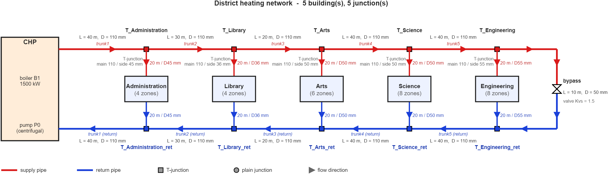

# DHS.System: assembling and running a district heating system

`DHS.System` is the top-level object of the district heating package. It owns one central heat
plant, one hydraulic network and any number of buildings, and it advances all of them together on a
fixed time step. You build a system by naming its parts and connecting them, then call `run`. The
code follows the plant diagram, so you can compare a script with the drawing.



## Example: one building on a plant

The script below builds an office hall with a PID-controlled substation valve and an occupancy schedule
from 07:00 to 18:00, draws the system and simulates one week. The hall has no internal loop, so its
substation is an ideal heat exchanger (see [heat exchangers](dhs-heat-exchanger.md)).

```matlab
% 1. The thermal model of the hall: one zone with a wall, a window and internal mass
rc = RCBS.Building();
rc.addStorey('S1');
rc.S1.addZone('Hall');
rc.S1.Hall.setAir(2e7, 20);                          % air capacity [J/K], initial temperature [degC]
rc.S1.Hall.addWall(0.0004, 3e8, [], 'Wall');         % R [K/W], C [J/K], initial temperature, name
rc.S1.Hall.addWindow(0.00067, 'Window');             % R [K/W]
rc.S1.Hall.addInternalMass(0.0002, 5e8, [], 'Mass');

% 2. The system, the plant (one boiler, one pump) and the network
sys = DHS.System('weather','solar_data_2025.csv', 'startDate',datetime(2025,1,1));
chp = sys.addCentralHeatPlant('CHP');
chp.addBoiler('B1', 'QMax',1.0e6);                   % burner capacity [W]
chp.addPump('P0', 'dp0',3.0e5, 'mdotRated',6);       % shut-off head [Pa], rated flow [kg/s]
chp.setSupplySetpoint(70);                           % supply temperature [degC]
hn = sys.addHydraulicNetwork();

% 3. The pipes: a supply pipe from the plant to a tee, and a return pipe back to the plant
tee1 = chp.supplyPort.addPipe(0.10, 40).addTee(0.05);      % diameter [m], length [m]; tee side diameter [m]
r1   = DHS.Hydraulic.Junction('R1', 'return');
r1.addPipe(0.10, 40).connect(chp.returnPort);

% 4. The building, its substation, its controller, its solar model and its schedule
b  = sys.addBuilding('Hall');
b.useRCModel(rc);
hx = DHS.IdealHeatExchanger('HX', 'Qnom',2e5);       % heat at the nominal temperature difference [W]
b.attachHeatExchanger(hx);
c = DHS.controllers.PID(0.14, 1.6e-4, 0);            % the valve holds the zone temperature at the setpoint
c.measure = @(sys) sys.Hall.Tzone;  c.reference = @(sys) sys.Hall.setpoint;
hx.valve.attachController(c);
b.attachSolar(DHS.Solar('winArea',struct('N',20,'E',20,'S',20,'W',20), 'SHGC',0.4, 'massFraction',0.1));
b.attachSchedule(DHS.Schedule('occStartHour',7, 'occEndHour',18, 'rampHours',1, ...
    'Tocc',21, 'Tsetback',18, 'gainOccW',20e3, 'gainMassFraction',0.3));

% 5. Join the building to the network: it hangs on the tee and drains into the return junction
tee1.portC.connect(b);
b.connect(r1);

sys.visualize();                                     % draw the assembled system
res = sys.run(days(7));                              % 10,081 one-minute steps
```

The run takes about 5 s. During occupied hours the zone temperature has a mean bias of +0.003 K and a
root-mean-square deviation of 0.021 K around the 21 degC setpoint, and it falls to 17.9 degC overnight. The
plant supply temperature stays between 69.4 and 75.5 degC. Over the week the boiler burns 13,585 kWh of
gas and the substation delivers 10,257 kWh. The energy balance closes to 1e-11 of the gas input
(`res.energy.closure_err`).

`run` returns a structure with one value per time step in every vector:

| Field | Content |
|---|---|
| `res.time`, `res.Tout` | Time stamps (`datetime`) and outdoor temperature (degC). |
| `res.plant.Tsupply`, `.Tboiler`, `.Treturn`, `.TreturnNet`, `.TsupSet` | Plant temperatures (degC): supply, boiler water, return header, return from the network, supply setpoint. |
| `res.plant.Qgas`, `.Qboiler`, `.Qdist_loss`, `.Qbase`, `.eta`, `.firing` | Gas input, heat to the water, distribution loss and base load (W), efficiency, burner firing fraction. |
| `res.plant.Mtot`, `.Mbypass`, `.dpPump`, `.pSupHeader` | Total flow (kg/s), the part that passes through the end-of-line bypass (0 without one), central pump head and supply-header gauge pressure (Pa). |
| `res.plant.pumpSpeed`, `.bypassPos` | Central pump speed and bypass valve position (0 to 1). |
| `res.bldg(i).name`, `.Tzone`, `.setpoint`, `.Tzones`, `.zoneNames` | Name, air temperature and setpoint (degC); per-zone temperatures of a multi-zone building. |
| `res.bldg(i).Twall`, `.Troof`, `.Tmass` | Wall, roof and mass node temperatures (degC). |
| `res.bldg(i).Qdeliv`, `.Qsolar`, `.Qint`, `.Qvent`, `.Qfreecool` | Heat delivered by the substation, solar gain, internal gain, ventilation loss and free cooling (W). |
| `res.bldg(i).valve`, `.pump`, `.mdot`, `.vel` | Valve position and booster pump speed (0 to 1; the pump is stopped by default), branch flow (kg/s) and velocity (m/s). |
| `res.bldg(i).Tint_sup`, `.Tint_ret`, `.mdot_int`, `.Qzones` | Internal loop supply and return temperature (degC), loop flow (kg/s), and the heat each zone receives (W, one column per zone). NaN or zero for an ideal substation. |
| `res.bldg(i).Tsup_hx`, `.Tret_primary`, `.pSup`, `.pRet` | Primary supply and return temperatures at the exchanger (degC) and gauge pressures at the tee (Pa). |
| `res.energy.gas_kWh`, `.boiler_kWh`, `.delivered_kWh`, `.dist_loss_kWh`, `.base_kWh` | Energy totals over the run (scalars). |
| `res.energy.plant_eff`, `.closure_err` | Delivered heat plus losses over gas input, and the relative closure error of the energy balance (scalars). |

## What happens in one time step

The scheme is sequential (Gauss–Seidel), with an inner loop that makes the plant supply temperature
consistent with the network return.

1. Sample the weather and call `stepFunction(sys)`, if there is one.
2. Each building's schedule and solar model give a setpoint, occupancy and heat gains.
3. Each building's controllers compute valve (and booster pump) commands. The central pump and the bypass valve run their own controllers, if any, on the previous step's measurement.
4. The hydraulic network is solved for flows, velocities and pressures.
5. The plant's firing controller sets the burner input.
6. Supply-pipe heat loss sets each exchanger's inlet temperature, each exchanger delivers heat, return-pipe loss and mixing set the plant return temperature, and the boiler is re-evaluated. This step repeats `couplingIterations` times.
7. The new water temperatures are committed to the plant.
8. Each building advances its RC model by one step.
9. The signals are logged.

## Start, step and stop functions

Three hooks let a script act on the system while it runs. Each is a function handle that receives the
whole system, `sys`, and may read or change anything in it.

| Hook | Called | Typical use |
|---|---|---|
| `sys.startFunction` | once, before the run | set parameters, prepare your own data |
| `sys.stepFunction` | at the start of every step, after the weather is sampled and before the controllers run | change parameters with time, log signals |
| `sys.stopFunction` | once, after the last step; `sys.result` holds the results | collect data, post-process, add fields to `sys.result` |

Inside a hook, `sys.time` is the start of the step, `sys.stepIndex` its number, and `sys.wx` its weather:
`Tout` and `Tground` (degC), `ghi`, `dhi` and `dni` (W/m²), the sun angles `sunZen`, `sunAz` and `sunEl`, and
`albedo`. The whole record is `sys.weather`. An anonymous function cannot assign values, so a hook that changes
something or stores data is a named function, which can sit at the end of the script. This script logs the
outdoor temperature, lets the boiler efficiency drift, changes the supply setpoint after 100 steps and adds a
field to the results:

```matlab
sys.startFunction = @startRun;  sys.stepFunction = @eachStep;  sys.stopFunction = @endRun;
res = sys.run(days(2));                          % res.meanTout is set by endRun

function startRun(sys)
    sys.plant.TsupSet = 65;                      % a parameter, before the run
    sys.userData.Tout = [];                      % your own data: here, a log of the outdoor temperature
end

function eachStep(sys)
    sys.userData.Tout(end+1) = sys.wx.Tout;                          % collect data
    sys.plant.boilers{1}.etaRef = 0.92 - 1e-6*sys.stepIndex;         % a parameter changing with time
    if sys.stepIndex == 100, sys.plant.TsupSet = 60; end
end

function endRun(sys)
    sys.result.meanTout = mean(sys.userData.Tout);                   % post-process
end
```

`sys.userData` is a structure that belongs to you. The toolbox never reads or changes it, so every hook and
controller can share data through it.

### Parts by name

You name every part when you create it, and that name is its handle. The plant is `sys.CHP`, with its
boilers and pump (`sys.CHP.B1.QMax`, `sys.CHP.P0.dp0`). A building is `sys.Hall`, with its exchanger, valve and
pump (`sys.Hall.HX.valve`), and its RC model by storey, zone and element: `sys.Hall.S1.Hall.Window.R`. A name
that is not a valid identifier, or that a property of `sys` already uses, is available only as
`sys.buildings{i}`. Writing `R` or `C` of an element changes the RC model, and the running simulation picks the
change up at its next step. This hook halves the window resistance at step 500:

```matlab
function windowHook(sys)
    if sys.stepIndex == 500
        z = sys.Hall.S1.Hall;
        z.Window.R = z.Window.R / 2;
    end
end
```

### Sharing data with controllers

An anonymous function copies the workspace variables it uses when you create it, so a later change to a
variable is not seen. Constant data, such as an occupancy table, can be captured this way. Data that changes
goes into `sys.userData` and is read through `sys`:

```matlab
occ = [zeros(1,300), ones(1,300), zeros(1,840)];            % one value per step
valve = DHS.controllers.Callback(@(sys, dt) 0.1 + 0.8*occ(sys.stepIndex));
sys.Hall.heatExchanger.valve.attachController(valve);
```

## Function reference

| Function or property | Inputs | Output or effect |
|---|---|---|
| `DHS.System('weather',csv, 'startDate',dt, 'timeStep',dur, 'couplingIterations',n, 'pumpFrac',f, 'baseHeatW',W, 'integrator',m)` | All optional. `weather`: Solcast-style CSV; `timeStep`: a `duration` (default 60 s); `couplingIterations` (default 2); `pumpFrac`: central pump speed, 0 to 1 (default 1); `baseHeatW`: constant heat taken from the plant outside the network (W, default 0); `integrator`: see [solvers](dhs-solvers.md) | A system with no parts yet. |
| `addCentralHeatPlant(name, ...)` | name; any plant property as name-value pairs | A `DHS.CentralHeatPlant` ([plant](dhs-plant.md)), reachable as `sys.<name>`. |
| `addHydraulicNetwork(...)` | any network property as name-value pairs (`'rho'`, `'mu'`, `'pReturnRef'`) | A `DHS.HydraulicNetwork` linked to the plant's ports ([hydraulics](dhs-hydraulic.md)). |
| `addBuilding(name, ...)` | name; any building property as name-value pairs (`'connD'`, `'connLength'`, `'Kminor'`, ...) | A `DHS.Building` ([building](dhs-building.md)), reachable as `sys.<name>`. |
| `setWeather(csv)` | path to a CSV file | Loads or replaces the weather source. |
| `compile()` | none | Freezes the topology. `run` calls it when needed. |
| `run(duration)` | a `duration`, for example `days(14)` | The result structure above. |
| `visualize()` | none | Draws the closed loop: the plant with its central pump, the supply and return pipes (name, length, diameter), every junction, and every building with its zone count and service pipes. |
| `.startFunction`, `.stepFunction`, `.stopFunction` | `@(sys) ...` | The user hooks above. |
| `.userData`, `.result` | structures | `userData` is yours. `result` holds the run's results while `stopFunction` runs, and `run` returns it afterwards. |
| `.time`, `.stepIndex`, `.wx` | none | Start of the current step, its number (1 for the first), and its weather sample. |
| `.weather` | `DHS.Weather` | The whole weather record. `sys.weather.at(sys.time + hours(3))` looks ahead. |
| `.plant`, `.network`, `.buildings`, `.nB` | none | The plant, the network, the buildings (a cell array) and their number. |
| `.pumpFrac` | 0 to 1 | Speed of the central pump when it has no controller. |
| `.baseHeatW`, `.cp` | W, J/kg/K | A constant plant-side heat sink (for example domestic hot water) and the water specific heat (4186). |

A weather file must cover the simulated period. `solar_data_2025.csv` covers 1 January to 30 June 2025;
outside its range `DHS.Weather` warns and uses the nearest sample.
