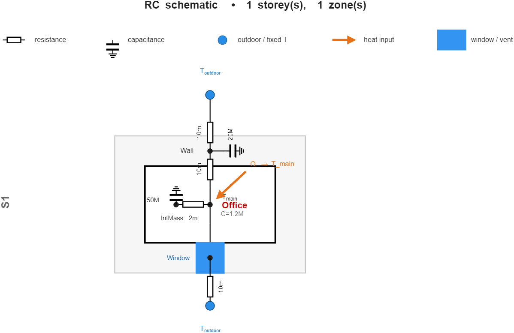

# RCBS: resistance-capacitance models of buildings

RCBS describes a building as a network of thermal resistances and capacitances (an RC model). A
building contains storeys, a storey contains zones, and a zone holds temperature nodes, resistors and
heat sources. You add one element at a time (a wall, a window, a block of internal mass), and RCBS
assembles the network, simulates it, and exports it as a continuous linear state-space model for
controller design or parameter identification. RCBS does not depend on the district heating package
`DHS`, so you can use it alone.



## How it works

For nodes with temperatures $T_i$, heat capacities $C_i$ and conductances $g_{ij} = 1/R_{ij}$, node $i$
obeys the energy balance

$$C_i\,\dot T_i = \sum_{j \ne i} g_{ij}(T_j - T_i) + g_{i,\text{out}}(T_{\text{out}} - T_i) + Q_i ,$$

where $g_{i,\text{out}}$ is the conductance to the outdoor boundary and $Q_i$ the heat injected at the node.
Stacked over all nodes this is $\mathbf C\,\dot{\mathbf x} = -\mathbf L\,\mathbf x + \mathbf g_{\text{out}} T_{\text{out}} + \mathbf q$,
with the diagonal capacitance matrix $\mathbf C$ and the conductance matrix $\mathbf L$. `getStateSpace` returns
the equivalent linear model

$$\dot{\mathbf x} = \mathbf A\,\mathbf x + \mathbf B\,\mathbf u,\qquad
\mathbf A = -\mathbf C^{-1}\mathbf L,\qquad
\mathbf B = \mathbf C^{-1}[\,\mathbf g_{\text{out}}\ \ \mathbf I\,],\qquad
\mathbf u = [\,T_{\text{out}};\,Q_1;\,\dots;\,Q_N\,].$$

**Elements.** Units are degC, W, K/W (resistance), J/K (capacity) and W/K (conductance).

| Element | Model | Added with |
|---|---|---|
| Air | One node with a capacity. | `setAir` |
| Wall, roof | A 2R1C T-network: one node with capacity $C$, joined to the air and to the outdoor boundary by $R/2$ each. The whole element is lumped into this one node. | `addWall`, `addRoof` |
| Window, vent | A conductance from the air to the outdoor boundary with no state. With a heat capacity it becomes a 2R1C element like a wall. | `addWindow` |
| Internal mass | One node joined to the air by a resistance. | `addInternalMass` |
| Zone link | A plain conductance (open doorway), or with a mid-node capacity an $R/2$–$C$–$R/2$ element (partition wall or floor slab). | `connectToZone` |
| Heat input | A function of the building, evaluated every step and injected at a node. | `connectToExternalSource` |

EN ISO 13790 and EN ISO 52016-1 use the same $R/2$–$C$–$R/2$ topology once for the whole envelope of a
zone. RCBS uses it once per construction element, so each element keeps its own state
([1](references.md#r1), [2](references.md#r2)).

**Time stepping.** The default solver is backward (implicit) Euler,

$$\left(\tfrac{1}{\Delta t}\mathbf C + \mathbf L\right)\mathbf x_{k+1} = \tfrac{1}{\Delta t}\mathbf C\,\mathbf x_k + \mathbf g_{\text{out}}\,T_{\text{out},k} + \mathbf q_k .$$

The left-hand matrix is constant, so it is factorised once and every step costs one back-substitution.
The method is stable for any step and first-order accurate. Set `simulation.solverMode` to `"exact"` for the
exact zero-order-hold solution or to `"forwardEuler"` for the explicit method (it warns when the step is too large).

## Example: one zone

A zone with a 1.2 MJ/K air node, a wall, a window and a block of internal mass. A heater gives 3 kW between
08:00 and 18:00.

```matlab
b = RCBS.Building();
b.addStorey('S1');
b.S1.addZone('Office');
b.S1.Office.setAir(1.2e6, 20);                        % air capacity [J/K], initial temperature [degC]
b.S1.Office.addWall(0.02, 2.0e7, [], 'Wall');         % R [K/W], C [J/K], T0 ([] = the air value), name
b.S1.Office.addWindow(0.01, 'Window');                % R [K/W]
b.S1.Office.addInternalMass(0.002, 5.0e7, [], 'IntMass');
b.S1.Office.connectToExternalSource( ...
    @(bb) 3000*(hour(bb.simulation.t) >= 8 && hour(bb.simulation.t) < 18), 'T_main');

b.outdoorTempFunc      = @(t) 4 + 8*sin(2*pi*(hour(t) - 8)/24);
b.simulation.startDate = datetime(2025,1,1);
b.simulation.timeStep  = minutes(15);

b.simulate(days(3));
T = b.simulation.results.S1.Office.T;                 % zone air temperature, one value per step
b.visualize();                                        % draws the schematic above
```

Over the three days the air temperature falls from 20.0 to 14.1 degC, with a daytime maximum of 22.4 degC.
`results` holds `Time` (a `datetime` vector), `Tall` (every node, one column each, in the order of
`nodeNames`), `OutdoorTemperature`, and one structure per zone (`results.S1.Office.T`, `.heatInput`).

The state-space model of the same building has three states (air, wall, internal mass) and four inputs
(outdoor temperature and one heat input per node):

```matlab
[sysc, io] = b.simulation.getStateSpace();            % needs the Control System Toolbox
size(sysc.A)                                          % 3 x 3
io.inputNames                                         % {'T_outdoor','Q_S1.Office.T_main','Q_S1.Office.Wall','Q_S1.Office.IntMass'}
```

## Example: two zones coupled by a partition

A laboratory heated with 1.5 kW shares a capacitive partition with an unheated corridor. The outdoor
temperature is 0 degC.

```matlab
b = RCBS.Building();
b.addStorey('S1');
b.S1.addZone('Lab');       b.S1.Lab.setAir(1.0e6, 20);
b.S1.addZone('Corridor');  b.S1.Corridor.setAir(0.6e6, 20);
b.S1.Lab.addWindow(0.01, 'Window');                   % 100 W/K to the outdoors
b.S1.Corridor.addWindow(0.02, 'Window');              %  50 W/K to the outdoors
b.S1.Lab.connectToZone(b.S1.Corridor, 0.02, 'Partition', 5e6);   % total R, name, mid capacity C_mid
b.S1.Lab.connectToExternalSource(@(bb) 1500, 'T_main');

b.outdoorTempFunc      = @(t) 0;
b.simulation.startDate = datetime(2025,1,1);
b.simulation.timeStep  = minutes(5);
b.simulate(days(8));
T = b.getAllZoneTemps();      % containers.Map: 'S1.Lab' -> 12.000, 'S1.Corridor' -> 6.000
```

A hand calculation gives the steady state. The partition conducts 50 W/K, so the corridor satisfies
$50(T_L - T_C) = 50\,T_C$, which gives $T_C = T_L/2$. The laboratory balance
$1500 = 100\,T_L + 50(T_L - T_C)$ then gives $T_L = 12$ degC and $T_C = 6$ degC. After eight days the
simulated values agree to three decimals.

## Change a parameter by name

Every wall, roof, window and internal mass is reachable by its name, and the air node as `Air`:

```matlab
z = b.S1.Lab;
z.Window.R = 2*z.Window.R;     % total resistance [K/W]; a wall's two halves move together
z.Air.T                        % temperature [degC], read only, live during a run
```

A wall has `R`, `C` and `T`. A window without a capacity has only `R`, and the air node has only `T`;
asking for anything else is an error. Writing `R` or `C` changes the model, and a running simulation rebuilds
itself at its next step and keeps the temperatures.

## Function reference

### `RCBS.Building`

| Function or property | Inputs | Output or effect |
|---|---|---|
| `RCBS.Building()` | none | An empty building with a 10 degC outdoor boundary. |
| `addStorey(name)` | `name`: a valid MATLAB identifier | Adds a storey, reachable as `building.(name)`. |
| `simulate(duration)` | a `duration`, or five numbers `(y,mo,d,h,min)` | Runs the model and writes `simulation.results`. Set `simulation.startDate` and `simulation.timeStep` first. |
| `visualize()`, `visualize('FontSize', f)` | none, or the base label size in points (default 8) | Draws the RC network: rooms, envelope T-networks, windows, internal mass, boundary terminals, heat inputs and zone links. |
| `getAllZoneTemps()` | none | `containers.Map` from `"Storey.Zone"` to the current air temperature (degC). |
| `.outdoorTempFunc` | `@(t)` returning degC for a `datetime` | The outdoor boundary condition. |
| `.simulation` | none | The `RCBS.Simulation` that belongs to the building. |
| `.storeyList` | none | The storey names, as a cell array. |

### `RCBS.Storey`

| Function | Inputs | Output or effect |
|---|---|---|
| `addZone(name, 'C_main', C)` | name; optional air capacity `C` (J/K) | Adds a zone, reachable as `storey.(name)`. |
| `.zoneList` | none | The zone names, as a cell array. |

### `RCBS.Zone`

| Function | Inputs | Output or effect |
|---|---|---|
| `setAir(C_air, T0)` | capacity (J/K); initial temperature (degC, optional) | Sets the air node. |
| `addWall(R, C, T0, name)` | total resistance (K/W), capacity (J/K), initial temperature (degC, `[]` for the air value), name | Adds a 2R1C wall. |
| `addRoof(R, C, T0, name)` | as `addWall` | Adds a 2R1C roof. |
| `addWindow(R, name)` | resistance (K/W), name | Adds an air-to-outdoor conductance with no state. |
| `addWindow(R, C, T0, name)` | resistance, capacity, initial temperature, name (`T0` and `name` optional) | Adds a 2R1C element like a wall. |
| `addInternalMass(R, C, T0, name)` | resistance to the air (K/W), capacity (J/K), initial temperature, name | Adds a mass node joined to the air node. |
| `addNode(name, C, T0)` | name, capacity, initial temperature | Adds a bare node, which you wire with your own resistors. |
| `connectToZone(other, R, name, C_mid, T0, kind)` | other zone; total resistance (K/W); name; optional mid capacity (J/K), initial temperature, and drawing hint `'wall'`, `'slab'` or `'air'` | A plain conductance if `C_mid` is omitted, a capacitive partition or slab otherwise. The mid node belongs to the calling zone. `kind` only changes the drawing. |
| `connectToExternalSource(hf, nodeName)` | `hf(building)` returning watts; node name (default `'T_main'`) | Injects `hf` at the node at every step. |
| `getNodeTemp(name)`, `setNodeTemp(name, T)` | node name, (temperature in degC) | Reads or writes the live node temperature. |
| `getMainTemp()` | none | The air-node temperature (degC). |
| `.<name>.R`, `.C`, `.T` | none | Parts by name (see above). |

### `RCBS.Simulation`

| Function or property | Inputs | Output or effect |
|---|---|---|
| `.startDate`, `.timeStep` | `datetime`, `duration` | The clock of the run (default 2000-01-01 and 10 min). |
| `run(totalSeconds)` | seconds | Advances the model and fills `results`. `Building.simulate` calls it. |
| `stepOnce(t, Tout, Q)` | step start (`datetime`), outdoor temperature (degC), heat per node (W) as a vector, a structure or a `containers.Map` | Advances one step and returns the node temperatures. `DHS` uses it for co-simulation. |
| `getStateSpace()` | none | `[sysc, io]`: a continuous `ss` model and a structure with `stateNames`, `inputNames`, `outputNames` and `zoneMainRows`. Needs the Control System Toolbox. |
| `measure(zoneKey, nodeName)` | zone key, node | The live node temperature during a run. |
| `plotResults()` | none | A quick plot of the stored temperatures. |
| `.controlFcn`, `.stepCallback` | `f(sim)`, `f(sim,k,t,T)` | Hooks called before and after each step, for closed-loop studies or logging. |
| `registerActuator(name, v0)`, `setActuator(name, v)`, `getActuator(name)` | name, value | A named value that your hooks and heat-source functions share. `.act` holds them. |
| `.solverMode` | `"cached"` (default), `"forwardEuler"`, `"exact"`, `"legacy"` | Backward Euler with a cached factorisation, explicit Euler, exact zero-order hold, or backward Euler with a dense solve per step (a reference). |
| `.warmStart` | logical (default false) | If true, a new run continues from the current state. |
| `.Tnow`, `.nodeNames`, `.k`, `.t` | none | Live node temperatures, their names, the step number and the time during a run. |

References for the element models and the integration are in [`references.md`](references.md). The accuracy
checks are in [`../validation/README.md`](../validation/README.md).
